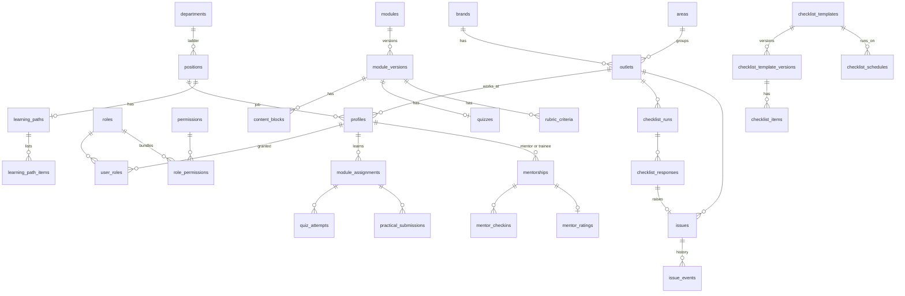

# ASAH MVP database (Supabase)

One migration creates the whole MVP schema: 48 tables, row-level security on every
table, permission-checked RPC functions, default roles and seed settings.

```
supabase/migrations/20261118000000_asah_mvp_schema.sql   the schema
test/00_supabase_stub.sql                                 fake auth schema, for plain Postgres only
test/10_behaviour_tests.sql                               40 access and workflow checks
```

## Apply

```bash
supabase link --project-ref <your-project>
supabase db push
```

Then enable the `pg_cron` extension and run the four `cron.schedule` lines at the end of
the migration (daily checklist runs, missed checklists, issue escalation, certificate reminders).

## Tables by module

| Module | Tables |
| --- | --- |
| Org structure | `brands`, `areas`, `outlets`, `departments`, `positions` (level = step on the department ladder) |
| Users and access | `profiles`, `permissions`, `roles`, `role_permissions`, `user_roles` (role + scope: group, brand, area, outlet) |
| Foundation | `app_settings`, `media_files`, `notifications`, `device_tokens`, `admin_audit_log` |
| Asuh: learning | `modules`, `module_versions`, `module_target_positions`, `content_blocks`, `questions`, `question_options`, `quizzes`, `quiz_questions`, `rubric_criteria`, `learning_paths`, `learning_path_items`, `module_assignments`, `block_progress`, `quiz_attempts`, `quiz_attempt_answers`, `practical_submissions`, `practical_scores`, `practical_spot_checks`, `certificates` |
| Asuh: mentorship | `mentorships`, `mentor_checkins`, `mentor_ratings`, `mentor_rating_access_log` |
| Aksi: checklists | `checklist_templates`, `checklist_template_versions`, `checklist_items`, `checklist_template_positions`, `checklist_schedules`, `checklist_runs`, `checklist_responses`, `checklist_response_photos` |
| Standar: issues | `issues`, `issue_events` (audits are checklist templates of kind `audit`) |
| Dashboards | views `v_outlet_daily_compliance`, `v_issue_resolution`, `v_training_progress` |



## How access works

- **Job is not access.** Department, position and level describe the job. What a person
  can do comes only from `user_roles`: a role (bundle of permissions) granted at a scope.
- **Default deny.** RLS is on for every table. A restrictive policy blocks inactive users
  everywhere; deactivating a user also removes their role grants and ends their mentorships.
- **Rules live in RPCs.** Anything with business rules is a `SECURITY DEFINER` function
  that checks permission first: `start_quiz_attempt`, `submit_quiz_attempt`,
  `submit_practical`, `score_practical`, `review_module_version`, `assign_mentor`,
  `submit_mentor_rating`, `my_mentor_rating`, `mentor_ratings_with_raters`,
  `submit_checklist_run`, `start_audit`, `raise_issue`, `assign_issue`, `fix_issue`,
  `verify_issue`, `my_permissions`.
- **Separation of duties.** A module's author cannot approve it; whoever fixes an issue
  cannot verify it; a trainee cannot score their own practical test.
- **Quiz answers stay on the server.** Staff never read `questions` or `question_options`;
  `start_quiz_attempt` serves questions without the correct option and grading is server side.
- **Anonymous mentor ratings.** `mentor_ratings` has no read policy. Mentors get an average
  only after 3 ratings (`my_mentor_rating`); only HR and senior management can see raters,
  and every such view is written to `mentor_rating_access_log`.

## Notes for the build

- Create users from the admin web through an Edge Function that calls
  `auth.admin.createUser({ phone })` with the service role, then inserts the `profiles` row
  and a `Staff` role grant at the user's outlet.
- `media_files` stores bucket and object key only. Storage buckets and their policies come
  with the media storage design later.
- Outlet time zones default to `Asia/Makassar` (WITA); set WIB or WIT per outlet as needed.
- Settings in `app_settings`: `mentor_rules` (min level 2, max 3 trainees, own path complete),
  `rating_min_count` (3), `certificate_reminder_days` (30), `require_geofence` (true).
